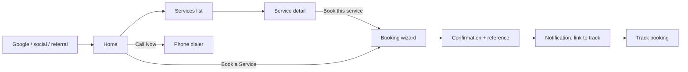
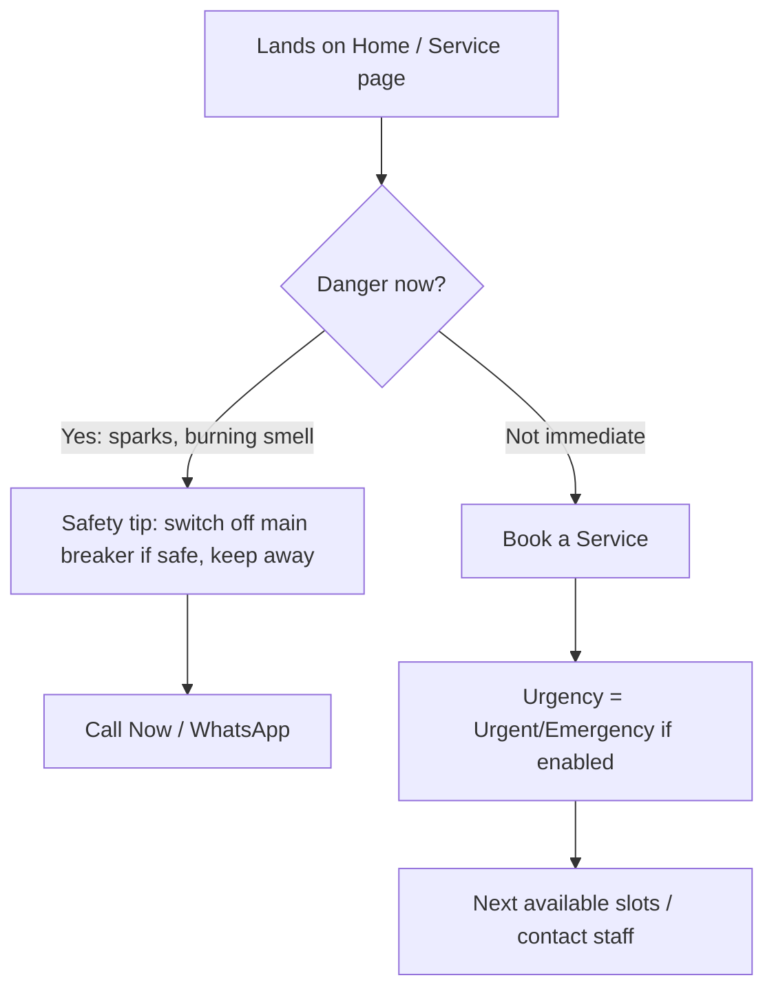
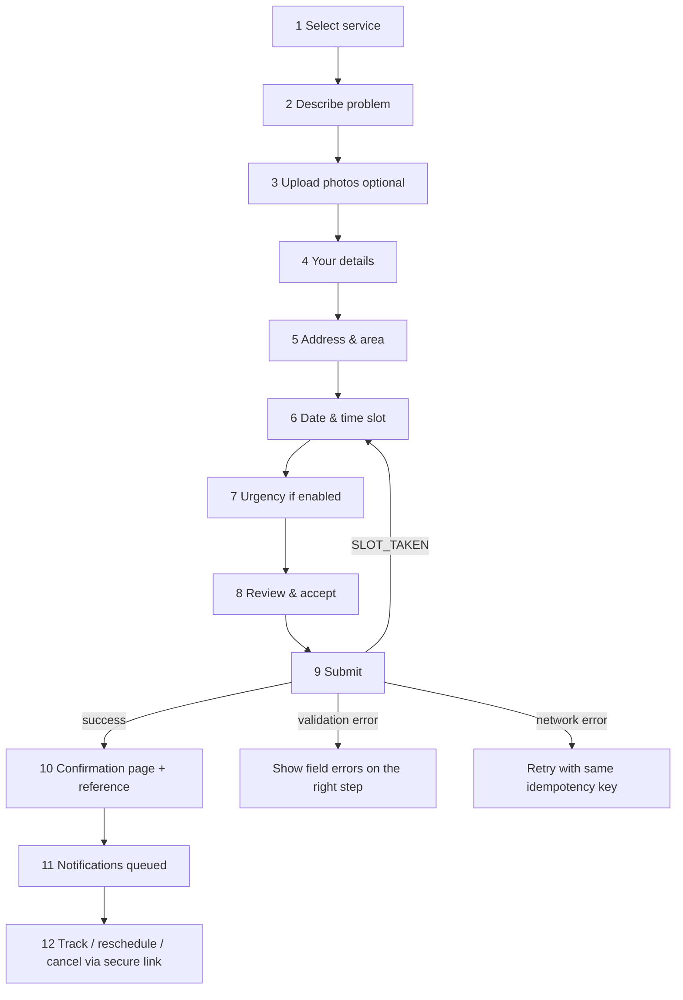
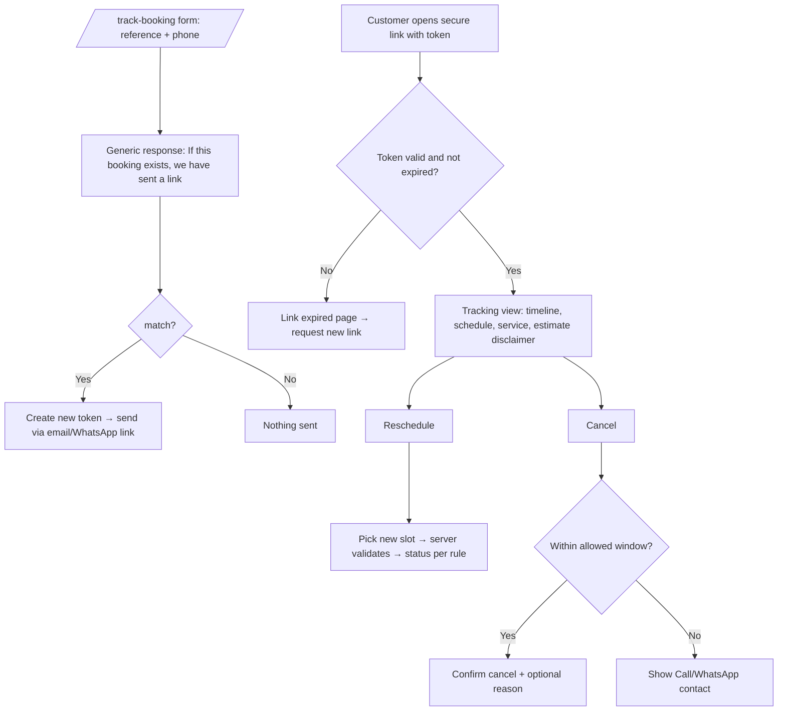
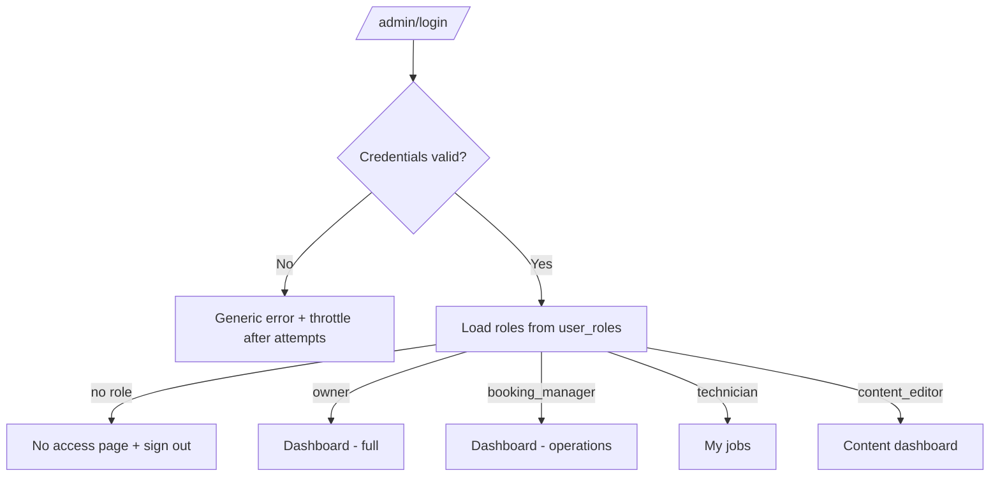
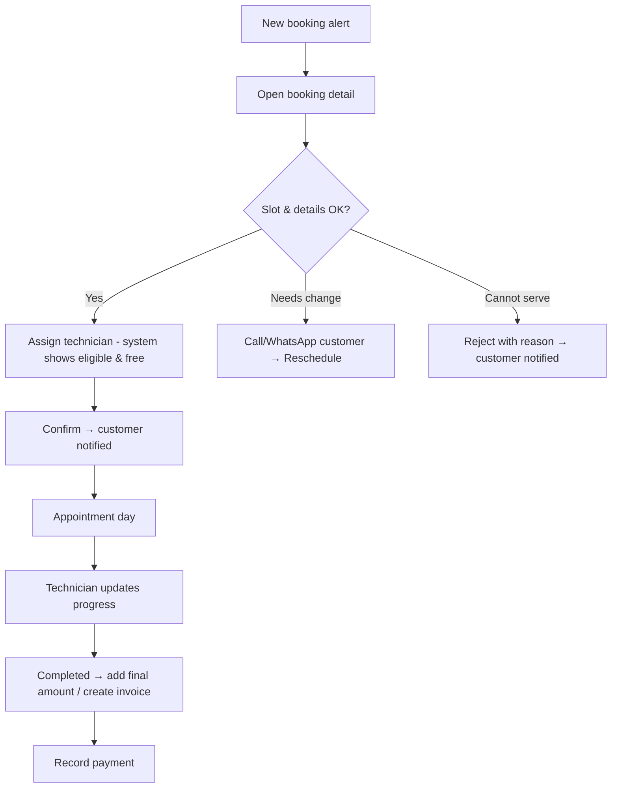
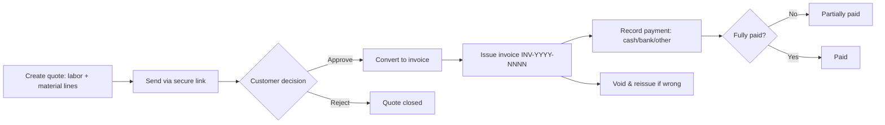
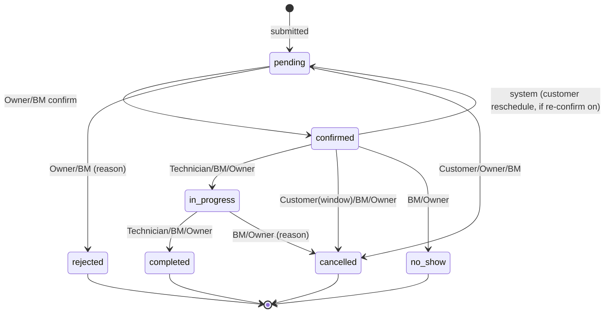

# 03 — APP FLOW (User & Admin Experience)
**Project:** ABC Electrician Services
Covers: site map, public journeys, booking wizard flow, tracking, admin journeys per role, status lifecycle, notifications, error/edge flows.

---

## 1. Site Map

```
PUBLIC (EN: /…   UR: /ur/…)
/                      Home
/services              Service directory
/services/:slug        Service detail  ──► /book-service?service=:slug
/book-service          Booking wizard
/pricing               Pricing & estimates
/about                 About & team
/projects              Portfolio
/projects/:slug        Project detail
/reviews               Reviews
/faq                   FAQ
/blog                  Blog list
/blog/:slug            Article
/contact               Contact + inquiry
/track-booking         Secure tracking
/privacy-policy        Privacy
/terms                 Terms
*                      404

ADMIN (noindex)
/admin/login
/admin/dashboard
/admin/bookings        /admin/bookings/:id
/admin/customers       /admin/customers/:id
/admin/services        /admin/services/new   /admin/services/:id
/admin/staff           /admin/availability   /admin/service-areas
/admin/projects        /admin/reviews        /admin/blog   /admin/faqs
/admin/quotes          /admin/invoices
/admin/notifications   /admin/analytics
/admin/settings        /admin/users          /admin/audit-logs
```

Global header actions on every public page: **Language switch**, **Call Now**, **Book a Service**. Mobile: hamburger menu + sticky bottom bar (Call Now | Book Service).

---

## 2. Public User Journeys

### 2.1 Residential visitor (discovery → booking)


### 2.2 Urgent customer

Rule: the site never promises arrival time unless configured by owner.

### 2.3 Commercial customer
Services → Commercial installation/maintenance → "Request inspection/quote" (booking with `inspection_required`) → staff visit → Quote shared via secure link → Approve/Reject → Job → Invoice.

### 2.4 Contact / inquiry
Contact page → fill form (Turnstile) → success message → inquiry stored → staff notification → Booking Manager marks handled / converts to booking.

---

## 3. Booking Wizard Flow

### 3.1 Step flow


### 3.2 Step specifications
| Step | Content | Validation | Notes |
|---|---|---|---|
| 1 Service | Service cards (preselected if `?service=`) | must pick bookable service | shows pricing label + duration |
| 2 Problem | textarea + common-issue chips (e.g., power cut in one room, tripping breaker) | 10–1000 chars | safety notice if keywords like "spark/burning" |
| 3 Photos | drag/drop or camera on mobile, preview, remove | ≤ 5, JPG/PNG/WebP, ≤ 5 MB | skippable, upload progress, retry per file |
| 4 Details | name, phone (PK format helper), email optional | phone normalized, shown as `+92 3XX XXXXXXX` | inline error messages in active language |
| 5 Address | address line, city → area (dependent select), postal optional | area must be active service area | out-of-area → message + call/WhatsApp CTA |
| 6 Schedule | date strip + available slot chips (Karachi time) | server-provided slots; refresh button | holidays/closed days disabled with reason; "no slots" empty state suggests next date |
| 7 Urgency | standard / urgent / emergency | optional per setting | urgent may extend slots / show phone CTA |
| 8 Review | summary card, estimate with disclaimer, terms + privacy checkboxes | both must be checked | edit links per section |
| 9 Submit | button with loading state, double-click safe | server revalidation | uses Idempotency-Key |
| 10 Confirmation | reference number (copy button), status "Request received – pending confirmation", schedule, what happens next, **Track booking** button, add-to-calendar (P1), WhatsApp share | — | tracking link shown once + sent by notification |

**Behaviors:** progress bar (Step X of 9), Back keeps data, draft in `sessionStorage`, focus moves to step heading on change (a11y), RTL mirrors progress direction, keyboard accessible.

### 3.3 Booking lifecycle (customer view)
`Request received (pending)` → `Confirmed` → `Technician on the way/In progress` → `Completed` ; or `Cancelled` / `Rejected` / `No-show` (customers see friendly wording and next-step suggestions).

---

## 4. Tracking Flow


Security: rate limiting on every tracking endpoint; no PII beyond first name, service, status, schedule, area.

---

## 5. Admin Flows

### 5.1 Authentication

Session timeout → redirect to login with return URL. Accounts are invited by Owner (no public signup).

### 5.2 Owner journey
Dashboard (KPIs, trends) → Pending bookings → Review → Settings (hours, holidays, areas, booking rules) → Staff & roles → Analytics (revenue: invoiced / collected / outstanding) → Audit logs.

### 5.3 Booking Manager — daily flow

Also: calendar drag-to-reschedule (conflict warning), internal notes, resend failed notification, search by reference/name/phone.

### 5.4 Technician flow (mobile-first)
My jobs (today / upcoming) → Job card (address, tap-to-navigate, tap-to-call, problem, photos) → **Start job** (In Progress) → add notes/photos (P1) → **Mark completed** (optional final amount if permitted by setting) → next job. Cannot see other technicians' jobs, customers list, revenue, or settings.

### 5.5 Content editor flow
Dashboard → choose module (Services content, Projects, Blog, FAQs, Testimonials/Reviews, Homepage blocks, Privacy/Terms) → edit EN + UR → SEO fields → Save draft → Preview → Publish/Unpublish. Cannot access bookings, customers, revenue.

### 5.6 Quote → invoice → payment

Issued invoices are immutable; corrections via void + new invoice (audited).

### 5.7 Customer data requests
Customer asks for correction/deletion → staff opens customer profile → "Data request" record → Owner approves → fields corrected or customer anonymized (invoice records retained as legally needed) → audit log entry.

---

## 6. Booking Status State Machine


Invalid transitions return a clear message ("This booking is already completed"). Each transition: history row + audit log + notification (per template config).

---

## 7. Notification Flow
| Trigger | To | Channel | Content |
|---|---|---|---|
| Booking submitted | Customer | Email (if given) + on-screen | Reference, "request received", tracking link |
| Booking submitted | Staff (Owner/BM) | In-app (+ email) | New booking summary |
| Confirmed | Customer | Email/WhatsApp link for staff to send | Date/time, technician first name (optional) |
| Rescheduled | Customer + staff | same | New time |
| Reminder 24 h / 2 h | Customer | Email | Time, address area, contact number |
| Rejected / Cancelled | Customer | Email | Reason (customer-safe) |
| Completed | Customer | Email | Thanks, review invite (P1) |
| Inquiry received | Staff | In-app/email | Inquiry summary |
Failure: attempt 1 → retry +1 min → +5 min → +30 min → mark `failed`, show red badge in booking detail and `/admin/notifications`, allow manual resend or WhatsApp link.

---

## 8. Error, Empty, and Edge States (global)

| Situation | Behavior |
|---|---|
| Slot taken during submit | Return to Step 6, refreshed slots, message "That time was just booked" |
| No slots on chosen day | Show next 3 days with availability; call/WhatsApp CTA |
| Out of service area | Explain, offer contact; log demand (anonymous) |
| Rate limited | Friendly "Too many attempts, try later" + call number |
| Upload failure | Per-file retry; submit allowed without photo |
| Network offline | Banner; form retained; retry |
| Expired token | Request-new-link flow |
| Admin lacks permission | 403 page; no data leaked |
| Service inactive/deleted | 404 with related services |
| API down | Booking page shows call/WhatsApp fallback |
| Maintenance mode | Static maintenance page; admin still accessible to Owner |

Loading: skeletons for lists/cards; button spinners with disabled state; optimistic updates only for non-critical toggles.

---

## 9. Language & Direction Flow
Visitor arrives → URL decides language (`/` EN, `/ur/` UR) → first visit may suggest Urdu based on browser language (non-blocking banner) → switch keeps the same page and form data → `lang`/`dir` update, layout mirrors, numbers/phones remain LTR → preference stored.

---

## 10. Permissions at a Glance (flow level)
| Action | Owner | BM | Tech | Editor | Public |
|---|---|---|---|---|---|
| Create booking | ✔ | ✔ | ✘ | ✘ | ✔ (wizard) |
| Confirm/reject | ✔ | ✔ | ✘ | ✘ | ✘ |
| Start/complete job | ✔ | ✔ | ✔ assigned | ✘ | ✘ |
| Manage content | ✔ | ✘ | ✘ | ✔ | ✘ |
| See revenue | ✔ | ✘ | ✘ | ✘ | ✘ |
| Manage users/settings | ✔ | ✘ | ✘ | ✘ | ✘ |
(Full matrix in PRD §G.)
